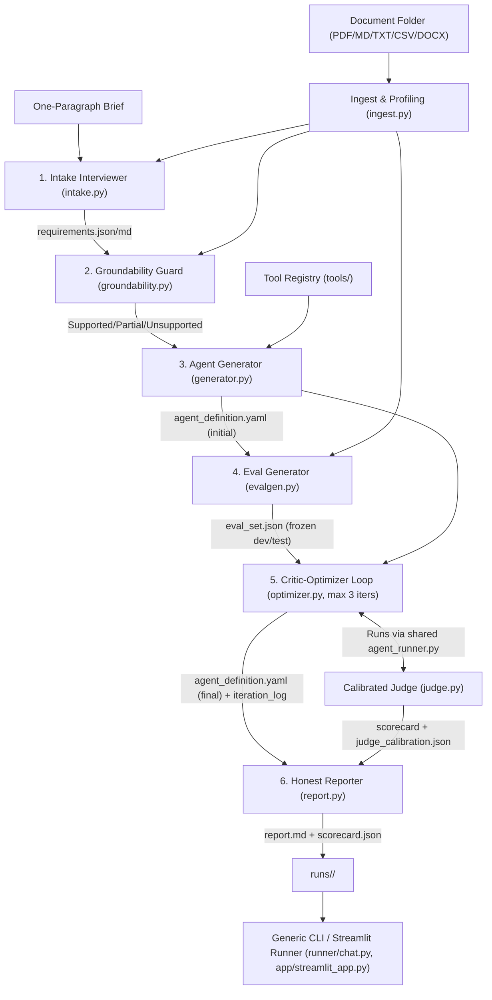

# ForgeAI — Implementation Plan & Architecture

ForgeAI is an autonomous, declarative agent-building factory. Given a one-paragraph brief and a folder of documents, it runs an end-to-end pipeline—intake interview, groundability guard, agent & tool synthesis, grounded eval generation, calibrated judging, targeted critic-optimizer loop, and honest reporting—producing a tested, documented, runnable agent definition (`agent_definition.yaml`).

---

## Architecture Overview



---

## Repository File Tree

```text
forgeai/
  __init__.py
  config.py            # .env settings, defaults, paths, factory version
  schemas.py           # Pydantic v2 models for all artifacts
  budget.py            # Token, call, latency, cache & budget enforcement
  llm.py               # OpenAI-compatible client, JSON repair loop, disk cache
  ingest.py            # PDF/TXT/MD/CSV/DOCX loader, chunker, doc profiler
  retrieval.py         # Hybrid BM25 + embedding retriever with cached embeddings
  agent_runner.py      # Shared execution engine (retrieval + tool loop + contract)
  intake.py            # Req 1: Doc profiling + <=5 clarifying Qs (interactive & unattended)
  groundability.py     # Req 2: Deterministic + LLM evidence guard
  generator.py         # Req 3: Agent definition synthesis + deterministic tool post-check + tournament
  evalgen.py           # Req 4: Grounded eval generation + quality filters + dev/test split
  judge.py             # Req 5: Deterministic + defended LLM judge + calibration self-test
  optimizer.py         # Req 6: Failure clustering + targeted patch/revert loop (max 3 iters)
  report.py            # Req 7: Honest report.md + scorecard.json + trust notes
  factory.py           # Orchestrator CLI with resume, budget, regression, checkpoint
  tools/
    __init__.py
    registry.py        # Declarative ToolSpec registry + trigger metadata
    csv_lookup.py      # Pandas lookup over ingested CSVs
    calculator.py      # Safe AST arithmetic evaluator (no eval/exec)
    open_meteo.py      # Keyless weather API with graceful offline handling
    current_date.py    # Current date/time tool
  prompts/             # All generation, judging, intake, and patching templates (.txt)
runner/
  __init__.py
  chat.py              # Req 8: Generic CLI chat runner using forgeai.agent_runner
app/
  streamlit_app.py     # Stretch: Deployable Factory + Chat Runner UI
demos/
  synthesis_prompts/   # Prompts used to generate synthetic demo documents
  hr_policy/           # Demo A: HR policy docs + brief + human_baseline.yaml
  ship_spares/         # Demo B: Spares CSV + supplier docs + brief
runs/
  hr_policy/           # Committed artifacts from unattended HR demo run
  ship_spares/         # Committed artifacts from unattended Ship Spares demo run
tests/                 # Pytest suite for all deterministic guarantees
PLAN.md
RESULTS.md
README.md
requirements.txt
.env.example
Makefile
```

---

## Implementation Task Checklist

- [ ] **Phase 1: Core Infrastructure** (`config.py`, `schemas.py`, `budget.py`, `llm.py`)
  - [ ] Pydantic schemas for all pipeline artifacts
  - [ ] OpenAI-compatible `LLMClient` with retries, timeout, disk cache, token/latency accounting
  - [ ] `json_call` with fence stripping, brace extraction, and max-3 Pydantic repair retries
- [ ] **Phase 2: Ingestion, Retrieval, Tools, Shared Runner**
  - [ ] Multi-format ingestion (`.pdf`, `.txt`, `.md`, `.csv`, `.docx`) + scanned PDF warning + doc profile
  - [ ] Configurable chunking (`fixed`, `paragraph`, `heading-aware`) with metadata
  - [ ] Hybrid BM25 + cached embedding retriever with `min_score` threshold
  - [ ] Tool registry: `csv_lookup`, AST-safe `calculator`, offline-safe `open_meteo`, `current_date`
  - [ ] Shared `agent_runner.py` with `<tool>{...}</tool>` protocol (max 3 hops) + `runner/chat.py`
- [ ] **Phase 3: Factory Pipeline Modules & Prompts**
  - [ ] All prompt templates committed under `forgeai/prompts/*.txt`
  - [ ] `intake.py`: hard cap <= 5 questions, interactive + `--non-interactive` modes
  - [ ] `groundability.py`: deterministic + LLM check, demotes unsupported topics to `must_refuse`
  - [ ] `generator.py`: declarative `agent_definition.yaml`, rationale for every tool, deterministic post-check, stretch prompt tournament
  - [ ] `evalgen.py`: >=20 cases, source-fact verification filter, OOS retrieval filter, dedup, dev/test split
  - [ ] `judge.py`: deterministic primary checks + defended LLM-as-judge + automatic calibration self-test
  - [ ] `optimizer.py`: max 3 iters, 4 failure classes, targeted patches, revert on drop, overfitting guard
  - [ ] `report.py`: honest `report.md` + `scorecard.json`, "WHAT STILL FAILS AND WHY", trust notes
  - [ ] `factory.py`: resumable CLI orchestrator (`--non-interactive`, `--human-checkpoint`, `--regression`, budget)
- [ ] **Phase 4: Tests, Demos & Documentation**
  - [ ] Comprehensive `pytest` suite passing
  - [ ] Synthesis prompts + Demo A (`hr_policy`) + Demo B (`ship_spares`)
  - [ ] Unattended end-to-end runs on both demos committed to `runs/`
  - [ ] Human baseline comparison + `RESULTS.md` + Streamlit UI + `README.md`

---

## Definition of Done Checklist

- [ ] pytest passes (calculator safety, chunking, deterministic judge checks, tool-selection post-check, JSON repair, question cap <=5, iteration cap <=3)
- [ ] `python -m forgeai.factory` runs unattended end-to-end on both demos with the configured LLM
- [ ] >= 20 generated eval cases each run, with filter stats logged
- [ ] Groundability guard demonstrably flags the planted unsupported topic in the HR demo
- [ ] Tool selection is correct for both demos (HR: no weather/csv; Spares: csv_lookup + calculator)
- [ ] Iteration logs show diffs, before/after scores, and at least one reverted or no-gain iteration is honestly reported if it occurs
- [ ] `report.md` explains remaining failures; no claim of 100%
- [ ] `runner/chat.py` works with both produced definitions
- [ ] `README.md`: setup (Ollama), how to run each stage, architecture diagram (mermaid), how the judge is defended, known limitations, how to run on an unseen brief
- [ ] All prompts committed in `forgeai/prompts/` and `demos/synthesis_prompts/`
