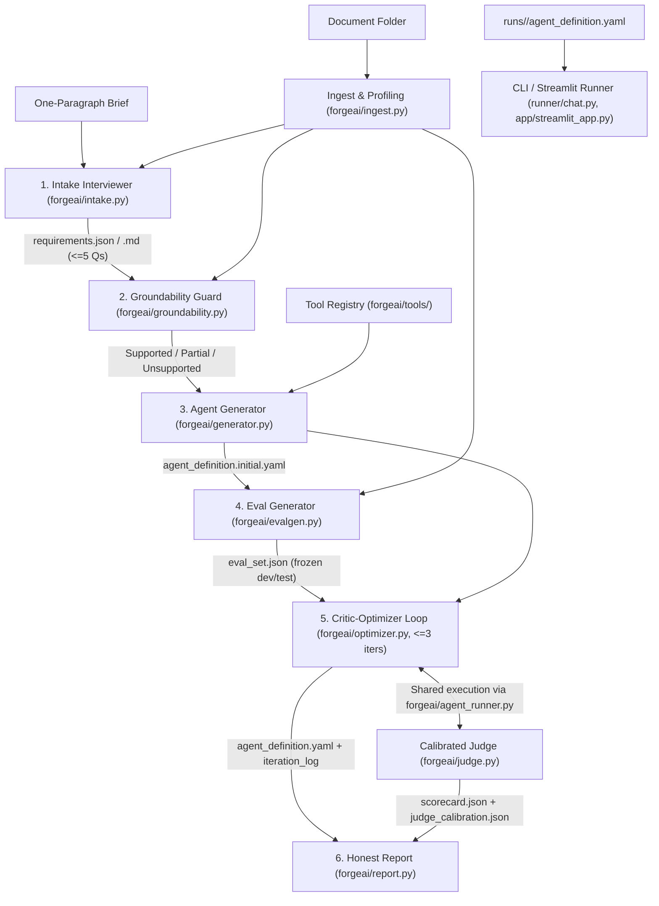

# ForgeAI — Autonomous Agent Factory

[](https://share.streamlit.io/)
[](https://www.python.org/downloads/)
[](LICENSE)

ForgeAI takes a one-paragraph brief and a folder of documents (`PDF`, `MD`, `TXT`, `CSV`, `DOCX`) and autonomously builds, evaluates, diagnoses, optimizes, and documents a grounded AI agent (`agent_definition.yaml`), then reports honestly on what works, what fails, and why.

**🚀 [Quick Deploy to Streamlit Cloud](STREAMLIT_DEPLOYMENT.md)** | **📖 [Full Documentation](#setup-gemini-api-ollama-is-optional)**

---

## Architecture



---

## Setup (Gemini API; Ollama is optional)

1. **Install Python dependencies** (Python 3.9+; the test suite was run on Python 3.9.6):
   ```bash
   pip install -r requirements.txt
   ```
2. **Configure Gemini**:
   ```bash
   cp .env.example .env
   ```
   Create an API key in [Google AI Studio](https://aistudio.google.com/apikey), then edit `.env`:
   ```dotenv
   LLM_BASE_URL=https://generativelanguage.googleapis.com/v1beta/openai/
   LLM_MODEL=gemini-3.1-flash-lite
   LLM_API_KEY=your-gemini-api-key
   EMBED_MODEL=local:sentence-transformers/all-MiniLM-L6-v2
   ```
   Keep `.env` private; it is excluded by `.gitignore`. Check Google's current model catalog and your account quotas before running a full factory build.
   FastEmbed downloads the selected embedding model the first time it is used; document and query embeddings are then generated locally.
3. **Or use another OpenAI-compatible API** by setting its base URL, chat model, API key, and a compatible embeddings model. To keep embeddings local, leave `EMBED_MODEL` set to the `local:` model above.
   ```bash
   # Edit LLM_BASE_URL, LLM_MODEL, LLM_API_KEY, EMBED_MODEL, and optionally JUDGE_MODEL in .env
   ```

---

## Running ForgeAI

### Run End-to-End Unattended on an Unseen Brief + Document Folder
```bash
python -m forgeai.factory \
  --brief path/to/brief.txt \
  --docs path/to/docs_folder \
  --run-name unseen_review \
  --non-interactive
```
Or via Makefile:
```bash
make demo-unseen BRIEF="Build an agent for ..." DOCS=path/to/docs RUN=unseen_review
```

### Key CLI Flags
- `--non-interactive`: LLM simulates the requester during intake (unattended execution).
- `--answers answers.json`: Supply pre-written answers for intake clarifying questions.
- `--max-questions 5`: Clarifying questions cap (hard-capped at 5 in code).
- `--max-iters 3`: Critic-optimizer loop cap (hard-capped at 3 in code).
- `--target 0.85`: Early-stop target score on `dev` split.
- `--token-budget 150000`: Hard uncached token budget per run.
- `--human-checkpoint`: Pause after intake to let the user review/edit `requirements.md`.
- `--tournament`: Run 3-candidate prompt tournament using both-order pairwise judging.
- `--force`: Re-run all stages instead of resuming from cached stage artifacts.
- `--regression --old-run runs/hr_policy --new-docs path/to/updated_docs`: Re-evaluate a frozen `eval_set.json` against updated documents.

### Run the Built-In Demos
```bash
make demo-hr
make demo-spares
```

### Chat with Any Generated Agent
```bash
python -m runner.chat --agent runs/hr_policy/agent_definition.yaml --docs demos/hr_policy/docs --debug
```

### Launch the Streamlit UI
```bash
make ui
```

---

## How the Judge Is Defended

ForgeAI treats LLM-as-judge as noisy and potentially biased, especially with small local models:
1. **Deterministic Primary Checks**: Exact key-fact token + number overlap, citation existence against retrieved chunks, refusal detection, contract compliance, and numeric hallucination detection against retrieved context + tool outputs.
2. **Position Bias Defense**: Pairwise comparisons (`pairwise_judge_both_orders`) run in both `(A, B)` and `(B, A)` orders and count only consistent winners.
3. **Criteria-Order Stability Defense**: Pointwise LLM judging runs twice at `temperature=0.0` with shuffled criteria ordering; any disagreement lowers confidence and falls back strictly to the deterministic verdict.
4. **Verbosity Bias Defense**: Rubric explicitly instructs the judge to ignore length, and `judge.py` flags responses exceeding `2.5x` reference length.
5. **Self-Preference Transparency**: Supports a separate `JUDGE_MODEL` env var and explicitly flags in `scorecard.json` and `report.md` when `JUDGE_MODEL == LLM_MODEL`.
6. **Automatic Calibration Self-Test**: Every run constructs gold vs deliberately corrupted answers (wrong numbers, fabricated claims, missing refusals, false refusals) and logs `judge_calibration.json`.

---

## Known Limitations

- **Small-Model JSON & Tool Discipline**: 3B models can still miss secondary facts or emit malformed tool arguments; `llm.py` repairs JSON up to 3 times and `agent_runner.py` caps tool loops at 3 hops.
- **Auto-Generated Eval Coverage**: Filtered synthetic evals verify source grounding and OOS non-overlap, yet cannot replace domain-expert red-teaming on production traffic.
- **Same-Model Judge**: When `JUDGE_MODEL` is unset, the generator and judge use the same model; deterministic metrics remain primary.
- **Provider Rate Limits**: The client follows retry/reset hints for HTTP 429 responses (up to 60 seconds per retry). The Makefile demos use 20 eval cases and one optimizer iteration; higher provider limits may be needed for additional runs.
- **Scanned PDFs**: PDFs without embedded text layers trigger explicit ingestion warnings rather than OCR.

---

## Running Tests

```bash
python -m pytest -v
```
